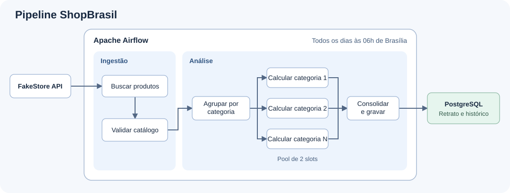

# Orquestração de Workflows

## Atividade 001 - Apache Airflow

### ShopBrasil

A atividade consiste na construção de um pipeline em Apache Airflow que substitui o script agendado via cron que alimentava o painel de preços da ShopBrasil. 
O pipeline consulta a FakeStore API e grava no PostgreSQL a média, o mínimo, o máximo e a quantidade de produtos de cada categoria.

Na solução, o Docker Compose inicia os serviços necessários do projeto e o Apache Airflow executa o pipeline diariamente às 6h (horário de Brasília, via Pendulum America/Sao_Paulo). 
* Se a consulta à API falhar, o Airflow repete a busca até três vezes, com intervalos crescentes, e registra o resultado nos logs.
* Após validar o catálogo, o pipeline cria uma tarefa de cálculo para cada categoria encontrada (fan-out), inclusive as novas, e permite até dois cálculos simultâneos.
* Os resultados são consolidados e gravados no PostgreSQL em uma única transação, que atualiza o retrato atual e o histórico sem duplicar registros ao reprocessar a mesma execução (idempotente). 

## Fluxo da Atividade

### Solução

A função _`buscar_produtos`_ consulta o catálogo e retorna os campos `category` e `price`. Busca, validação e agrupamento formam o trecho linear. A tarefa _validar_produtos_ verifica a categoria e o preço de cada produto antes do agrupamento. A DAG usa TaskFlow, organiza o fluxo nos TaskGroups `ingestion` e `analysis` e passa os resultados entre as tarefas por XCom. Os preços do agrupamento por categoria são exibidos no log. 

Na prática, verifica-se o pipeline:
- dispara sozinho a DAG diariamente às 06h de Brasília;
- resiste às falhas e se as tentativas se esgotarem, o alerta fica no log e o banco conserva o último resultado;
- escala quando surge uma categoria nova;
- limita cálculos simultâneos e gravação em duplicidade;
- emite alerta de falha;
- é modular e legível.

### Verificação

O script original era disparado pelo cron, mas podia deixar o painel desatualizado se a API falhasse. Rodar o script de novo também podia duplicar registros. Na ShopBrasil, o Airflow controla a execução: repete a consulta quando há falha, distribui os cálculos pelas categorias que encontra no catálogo e só libera a gravação depois que todos os cálculos terminam.

O arquivo shopbrasil_prices.py reúne essas etapas na DAG. 
 - O Docker Compose inicia o Airflow e os dois bancos PostgreSQL;
 - Na primeira inicialização do banco da ShopBrasil, o _init.sql_ cria as tabelas que guardam os números atuais e o histórico por execução.
 - A DAG grava, na mesma transação, em ambas, para evitar atualização parcial.

Em testes de integração com assistência de IA, executou-se a DAG com a FakeStore API e obteve-se 20 produtos em quatro categorias. Repetiu-se a gravação da mesma execução e foi confirmado que nenhuma linha foi duplicada. 
Em testes, Uma API simulada retornou HTTP 503 na primeira chamada. O Airflow repetiu a consulta e calculou as métricas de cinco categorias, incluindo uma que não estava no catálogo da primeira execução. 
Em testes, simulou-se uma falha na gravação e confirmei que os dados anteriores permaneceram nas duas tabelas. O teste com a API real foi disparado manualmente. Ao fim, o Airflow já tinha registrado a próxima execução automática para as 6h, no horário de Brasília.